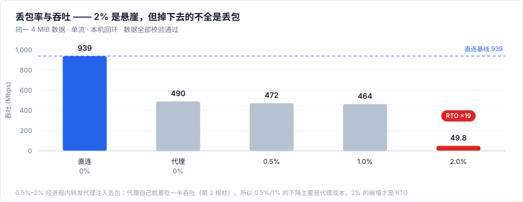
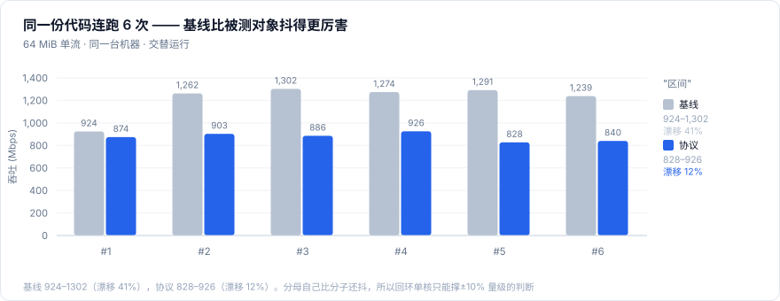
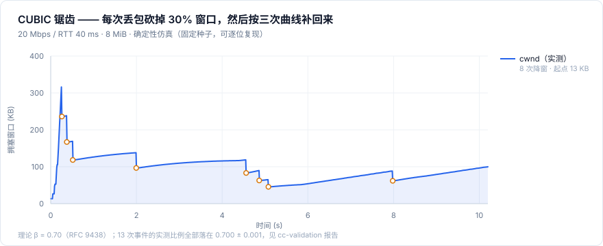
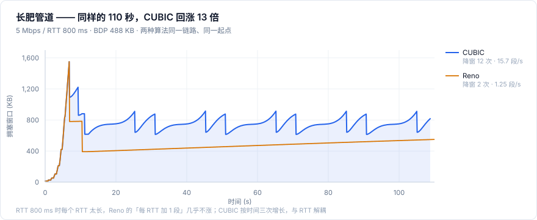

# xport

**基于 UDP 的 C++20 可靠传输框架** — 可靠 · 有序 · 多流复用 · 零第三方依赖


协议语义对齐 QUIC / RFC，线格式完全自研（不与标准 QUIC 互通）。
同一个 `IoEndpoint` 抽象下有两套后端：**确定性链路仿真器**与**真实 UDP socket**，上层代码零改动。

---

## 关键结果

| 单流回环吞吐 | 降窗比例 | 理论曲线偏差 | 热路径堆分配 |
|---:|---:|---:|---:|
| **~900 Mbps** | **0.700** | **0.7%** | **0 次/包** |

裸 UDP 天花板约 1.2 Gbps · 13 次拥塞事件的降窗比例全部为 0.700（理论 β = 0.7）·
理论曲线由 Python 按 RFC 独立回算 · 原实现为 2 次/包、34 次/ACK

---

## 架构


**分层原则**：`Transport` 不认识网络。它只依赖 `IoEndpoint` 的
`Send(Bytes, Time)` 与 `Recv(Batch*, Time)`，所以"跑仿真"和"跑真 socket"是同一条代码路径。
这不是为了优雅，是因为只有把时间从端点外部注入，仿真才可能 100% 确定。

> 代价：单连接吞吐上限 = 单核。扩展方向是多连接多线程，而不是把单个连接拆成收发两个线程。

---

## 快速开始

```bash
git clone https://github.com/haowu1234/xport.git && cd xport

# A. 一键编译，无需 CMake（自动挑 g++ / clang++ / ziglang）
./scripts/quickbuild.sh          # 编译 + 跑测试
./scripts/quickbuild.sh --run    # 再跑 demo 与轨迹探针
```

```bash
# B. CMake
cmake -S . -B build -G Ninja -DCMAKE_BUILD_TYPE=Release
cmake --build build
./build/tests/xport_tests        # 36 个用例
./build/apps/xport_demo --mb 16 --streams 4 --loss 2
```

<details>
<summary><b>Windows / MSVC</b></summary>

```powershell
cmake -S . -B build -A x64
cmake --build build --config Release
.\build\tests\Release\xport_tests.exe
.\build\apps\Release\xport_demo.exe --mb 16 --streams 4 --loss 2
```

</details>

<details>
<summary><b>demo 参数</b></summary>

| 参数 | 说明 |
|---|---|
| `--mb <n>` | 数据量（MB，默认 8） |
| `--streams <n>` | 并发流数（默认 1） |
| `--loss <pct>` | 丢包率百分比（默认 1） |
| `--dup <pct>` | 重复率百分比（默认 0） |
| `--bw <mbps>` | 链路带宽（默认 200，0 表示不限速） |
| `--delay-ms <n>` | 单程延迟（默认 1.0） |
| `--jitter <us>` | 抖动微秒（默认 0） |
| `--seed <n>` | 随机种子（默认 42，同种子结果完全可复现） |

</details>

---

## 实测数据

### 真实 socket · 本机回环

单流、单线程忙轮询、`127.0.0.1`，数据逐流校验通过。

| 场景 | 吞吐 | 备注 |
|---|---:|---|
| 单流 8 MiB | **923.9 Mbps** | 67.1 Mbit / 72.6 ms |
| 单流 64 MiB | 903.3 Mbps | 长样本，更可信 |
| 单流 256 MiB | 881.4 Mbps | 持续满载 2.4 s，略有降频 |
| 8 条并发流 16 MiB | 864.6 Mbps | 报文更碎，调度开销上升 |
| 小消息 1600 × 200 B | **400 个包** | 帧聚合开启；关闭时需 1600 个包 |
| 1% 真实丢包 | 463.7 Mbps | 重传 32 包即恢复 |
| 2% 真实丢包 | **49.8 Mbps** | 19 次 RTO 停顿 —— 缺 PTO，见下 |



> **关于"达成率"要诚实说明**：同一配置连跑 6 次，协议吞吐落在 **828–926 Mbps**，
> 而裸 UDP 基线自己在 **924–1302 Mbps** 之间漂移（41%）。配对后达成率 **64%–95%，中位约 70%**。
> 基线比被测对象抖得更厉害，所以回环单核只能做 ±10% 量级的判断，不足以验证 5% 以内的优化收益。



**两个结论：**

**① 瓶颈 100% 在系统调用。** 每包 2.22 次 syscall、约 10 µs 进内核；协议自身只有 ~250 ns（<3%）。
回环上 cwnd 涨到 8 MB，实际在途却只有 10 KB —— 窗口开得再大也没用。

**② 2% 丢包掉到 50 Mbps，是缺 PTO。** 回环 RTT 0.15 ms，而 RTO 下限是 200 ms（差 1300 倍）。
窗口尾部的丢包触发不了三次重复 ACK，只能干等 200 ms。五次运行耗时 76/76/276/480/878 ms，
完全由 RTO 次数决定（RTO=0 → 448 Mbps，RTO=16 → 71 Mbps）。
**这个缺陷只有真实 socket 能暴露** —— 仿真里 RTT 是 2–800 ms，200 ms 的下限从来不是瓶颈。

### 确定性仿真

200 Mbps 链路、RTT 2 ms、8 MiB 数据：

```console
$ ./build/xport_demo --mb 8 --loss 1
 有效吞吐      62.6 Mbps  (7.83 MB/s)
 发送          6301 包  (重传 77 · 1.22%)
 拥塞窗口      17.2 KB  (ssthresh 7.8 KB)
 拥塞控制      cubic · cong-avoid · 事件 55 次 · pacing 85 Mbps
 流控          MAX_DATA 上限 10240.0 KB · 已发 8192.0 KB · 阻塞 0 次
 SRTT          2.07 ms   (RTO 200.0 ms)
 校验          [OK] 逐字节一致  8388608 字节
```

```console
$ ./build/xport_demo --mb 32 --loss 0
 有效吞吐      195.1 Mbps  (24.39 MB/s)     # 线速的 97.6%
 拥塞控制      cubic · cong-avoid · 事件 5 次
 校验          [OK] 逐字节一致  33554432 字节
```

### 单核成本

| 指标 | 结果 | 说明 |
|---|---|---|
| 单包协议成本 | 收 **0.42 µs** / 发 **1.05 µs** | 单核上限：接收 27.5 Gbps、发送 56 Gbps（不含内核） |
| 稳态 ACK 成本 | **0.4–1.0 µs，与在途包数无关** | 优化前 16→4096 包涨 61 倍（0.8→49 µs） |
| 热路径堆分配 | **0 次/包** | 区间表、包号位图、流表全换定长结构 |
| 接收缓冲落地 | 0.49 → **0.03 ns/B** | 每流预分配环形缓冲，8 Gbps 单流仅占单核 29% |
| 回环 RTT | **9.0 µs**（64 B ping-pong） | 决定了 200 ms 的 RTO 下限是 RTT 的 1300 倍 |

### 拥塞控制

CUBIC 的可信度不来自"跑得快"，来自**曲线能被独立算出**。每张图的数据都是固定种子的确定性仿真，
换台机器重跑逐位一致。



同样的 110 秒、同一条 5 Mbps / 800 ms 的长肥管道，换算法就能看出差别：



逐事件的降窗比例、K 值与理论曲线偏差，全部列表在 [cc-validation.html](docs/cc-validation.html)。

---

## 文档

| 报告 | 内容 |
|---|---|
| [**udp-benchmark.html**](docs/udp-benchmark.html) | 真实 socket 回环基准 · 11 张图 / 7 张表 |
| [**cc-validation.html**](docs/cc-validation.html) | 拥塞控制正确性验证 · 逐事件降窗比例与理论曲线对照 |
| [**benchmarks.md**](docs/benchmarks.md) | 仿真性能矩阵 · 丢包扫描 / 带宽扫描 / 多流 / CUBIC vs AIMD |
| [**scaling.md**](docs/scaling.md) | 单流带宽上限分析 · 从 1 Gbps 到 400 G 的瓶颈推算 |

**关于验证方法**：CUBIC 的理论曲线由 Python 按 RFC 独立回算，不复用 C++ 实现。
拿自己的实现证明自己正确，是自证循环，不成立。

---

## 能力矩阵

| 能力 | 状态 | 说明 |
|---|:---:|---|
| 20 B 定长头 + CRC16 | ✅ | 解析在一条 cache line 内完成 |
| varint（1/2/4/8 B） | ✅ | 对齐 RFC 9000；超 62 位拒绝而非静默截断 |
| 帧编解码 | ✅ | STREAM / ACK / MAX_DATA / PING，含截断与非法帧防御 |
| 帧聚合 | ✅ | 一个报文最多 16 个 STREAM 帧（可跨流），小消息 pps 降 4 倍 |
| ACK | ✅ | **显式区间**（最多 16 段），不是位图窗口 |
| 包级可靠传输 | ✅ | 滑动窗口 + 包阈值 3 + 时间阈值 1.125×RTT |
| 恢复期去重 | ✅ | 降窗前发出的包再丢不算新事件，避免一次拥塞被反复砍 |
| RTO 与重传 | ✅ | RFC 6298：初始 1 s、下限 200 ms；重传按 offset 去重 |
| 流级重组 | ✅ | 区间合并、乱序缓存、重复包幂等 |
| 接收缓冲生命周期 | ✅ | **消费式**：环形缓冲 + `Peek` 零拷贝 + `Consume` 归还 |
| 多流复用 | ✅ | **DRR**，按字节公平 |
| 拥塞控制 | ✅ | **CUBIC**（RFC 9438）+ 快速收敛 + Reno 友好区；可切 Reno 对照 |
| 慢启动退出 | ✅ | **HyStart++**（RFC 9406） |
| pacing | ✅ | 令牌桶，慢启动 2×、拥塞避免 1.25×，突发 8 包 |
| 流控 | ✅ | MAX_DATA 连接级窗口 + 随 ACK 捎带 + 探测防死锁 |
| 真实 socket 后端 | ✅ | `IoEndpoint` + Winsock / BSD，非阻塞轮询 |
| 握手 / CID 协商 / cookie | ❌ | 当前两端静态配对，窗口由配置约定 |
| 加密 | ❌ | v1 明文 |
| 批量收发 | ❌ | 每包一次 `send`/`recv`，真实链路上的第一瓶颈 |
| PTO | ❌ | 只有 RTO；低 RTT 链路上 200 ms 下限会主导耗时 |
| GSO / GRO | ❌ | 帧聚合已在协议层就绪，缺内核 offload 那部分收益 |

---

<details>
<summary><b>设计约束 — 13 条，每条都对应一个真实踩过的坑</b></summary>

1. **`pkt_num` 与 `stream_offset` 分离**。重传必须换新包号，但字节位置不变。早期用"连续包号"做累积确认，包号空洞永远填不上，`acked_off` 被后续包顶到末尾，中间数据被误判"已确认"而永久丢失。
2. **ACK 帧不能再假设"窗口足够小"**。64 字节缓冲区在 16 段区间时溢出，`EncodeAck` 失败后静默返回，ACK 永久停发，发送端只剩 RTO 空转。
3. **初始 RTO 必须大于链路 RTT**。设成 90 ms 时，RTT=100 ms 的链路上每个包都在 ACK 到达前超时，每个 RTT 降一次窗，三次后塌到最小窗口。
4. **一次拥塞只能降一次窗**。同一窗口多个包同时判丢，每个都算一次事件的话，cwnd 会以 RTT 为周期连续乘 0.7，几秒内指数衰减到最小值。用恢复期去重解决。
5. **仿真器的队列要按"串行化积压"计量**。用"队列里的包数"会把传播途中的包也算进容量，标称 100 ms 的缓冲区实际只剩几十毫秒，HyStart 这类基于 RTT 增长的算法全部失效。
6. **"记不下"必须返回失败**。区间表满了就丢最老记录，而发送端是"先记区间、再释放包槽"——区间没记进去、包已删，那段数据永远不重传。现象极迷惑：200 Mbps 正常，1 Gbps 卡在 3.1 MB 不动。现在 `Add()` 返回 `bool`，失败整段重入重传队列，并计 `ack_overflow`。**能静默降级的地方一定要有计数器。**
7. **测试断言也要能自证**。流控用例原本用 64 KB 窗口断言"一定被挡住过"，但该链路 BDP 只有 25 KB，永远追不上额度 —— 用例一直是假通过。改成 16 KB 才真正触发门控。
8. **接收缓冲必须由应用归还**。每流预分配环形缓冲，`Peek` 取走、`Consume` 归还。收包热路径零缺页（1138 → 421 ns/包），代价是**调用方必须消费**：不消费窗口就不前进，对端被背压挡住。这是有意设计，不是 bug。
9. **流控窗口同时是内存预算**。`initial_max_data` 决定环形缓冲要分配多少。曾有基准把它设成 1 TB 来"关掉流控"，改造后直接 `bad_alloc`；现在硬夹到 1 GB，越界写有 `rx_overflow` 兜底。
10. **仿真器是独立库，不是测试代码**。固定种子 100% 可复现，把"偶发丢包导致的 bug"变成可调试的确定性问题 —— 上面一半缺陷是这样定位的。
11. **IO 端点不能自己缓存时间**。`Send` 没带 `now` 时仿真端点用了缓存的 `now_`（初值 0），所有包时间戳停在 0，RTO 成批触发，36 个测试里 7 个丢包用例全线失败。**时间必须由驱动方给，端点不许自己记。**
12. **RTO 下限在低 RTT 链路上会变成主导项**。200 ms 在 RTT 2 ms 的仿真里是安全网，在 RTT 0.15 ms 的回环上等于让传输反复睡 200 ms。正解是 QUIC 的 PTO（几个 RTT 的探测包，超时不降窗）。
13. **回环验证不了拥塞控制**。回环没有队列、没有带宽限制、没有随机丢包，cwnd 一路涨到上限；每包一次 syscall 让实际在途只有 10 KB，远小于 BDP。回环能验证正确性与单核处理能力，拥塞控制只能靠确定性仿真。

</details>

<details>
<summary><b>目录结构</b></summary>

```
include/xport/
  types.h       基础类型、MTU、Stats
  bytes.h       大端读写 + 边界检查的 Reader/Writer + varint
  crc32c.h      头部校验
  packet.h      报文头与帧编解码（ACK 用显式区间，一包多帧）
  ranges.h      定长区间表 RangeSet（替代 std::map，热路径零分配）
  hash.h        增量 FNV 哈希（流式校验，不保留全量数据）
  cc.h          CUBIC + HyStart++ + pacing 速率（纯数学，可单测）
  io.h          IoEndpoint 抽象
  sim.h         确定性链路仿真 + SimEndpoint
  udp.h         真实 UDP socket 后端（Winsock / BSD）
  transport.h   连接：可靠传输、重组、流控、DRR 调度
src/            对应实现
tests/          test_framework.h（自研，零依赖）+ wire / cc / transport 用例
apps/           xport_demo       演示
                xport_bench      仿真矩阵压测
                xport_ccprobe    轨迹探针
                xport_cpubench   单包 CPU 成本
                xport_udp_bench  真实 socket 回环基准
docs/           四份报告（见上表）
docs/figs/      README 内嵌图表（独立 SVG，由 scripts/plot_readme.py 生成）
scripts/        quickbuild.sh · plot_cc.py · plot_udp.py · plot_readme.py
```

</details>

<details>
<summary><b>复现图表</b></summary>

```bash
# 拥塞控制轨迹 → docs/cc-validation.html
./build/xport_ccprobe --scenario cubic    --out build/traces/cubic.csv
./build/xport_ccprobe --scenario longhaul --algo cubic --out build/traces/longhaul_cubic.csv
./build/xport_ccprobe --scenario longhaul --algo reno  --out build/traces/longhaul_reno.csv
./build/xport_bench --csv build/bench.csv
python scripts/plot_cc.py

# 真实 socket 回环 → docs/udp-benchmark.html
./build/xport_udp_bench --sweep --csv build/udp_bench.csv
python scripts/plot_udp.py

# README 内嵌图表 → docs/figs/*.svg
python scripts/plot_readme.py
```

`xport_udp_bench` 主要参数：`--mb` 数据量 · `--streams` 并发流 ·
`--window` 接收窗口 · `--relay-loss` 进程内转发代理注入真实丢包 ·
`--no-coalesce` 关闭帧聚合做 A/B · `--sweep` 跑完整矩阵

</details>

---

## 路线图

按「收益 ÷ 工作量」排序：

| # | 事项 | 为什么现在是它 |
|---|---|---|
| 1 | **PTO（探测超时）** | 把窗口尾部落丢的恢复从 200 ms 压到 ~2×RTT。回环数据已证明这是低 RTT 链路的最大单点，改动局限在丢包检测，不碰拥塞控制 |
| 2 | **批量收发** | Windows `WSASendMsg` + IOCP 预投，Linux `sendmmsg`/`recvmmsg`。批量 32 能把 10 µs/包 摊掉一个数量级，是突破 1 Gbps 单流的唯一杠杆 |
| 3 | **真实网卡 bench** | 回环测的是 syscall 成本，真实网卡还要加中断、DMA、GRO。到那一步才有"单流 6–7 Gbps"的结论 |
| 4 | **`tc netem` 故障注入 + 24h 长稳 + 与 msquic 对比** | 拿到可信的工程结论，而不是"跑得快" |

---

<div align="center">
<sub>协议语义对齐 QUIC / RFC 9000 · 9438 · 9406 · 6298，实现与线格式独立</sub>
</div>
