# BBR v1 / v2 / v3 与 CUBIC 对比实验

吞吐、排队时延、公平性三个维度，全部在确定性仿真链路上跑，固定种子、逐位可复现。

## 结论

| 维度 | 结论 |
|---|---|
| 随机丢包下的吞吐 | v1 几乎不受影响（2% 丢包仍有 46.9 Mbps）。v2/v3 在丢包率接近 2% 阈值时主动降速（2% 时 30.0 / 26.4 Mbps），这是设计行为。CUBIC 在 0.1% 丢包时就只剩 10 Mbps |
| 排队时延 | 单流时三个 BBR 都把平均排队压在 2 ms 以内，CUBIC 会把缓冲填满（8 BDP 时平均 264 ms）。v2 最低（p95 0.4 ms），v3 因为 UP 阶段 cwnd_gain 2.25 的探测，p95 到 18 ms |
| 浅缓冲丢包 | 0.5–1 BDP 缓冲、无随机丢包时，v3 的重传率是 v1 的 1/2 到 1/10（1 BDP：0.04% 对 0.37%）。这正是 inflight_hi 的作用 |
| 同算法多流公平 | 2 BDP 时 v2/v3 的 Jain 指数（0.94 / 0.95）高于 v1（0.81）。0.5 BDP 时反过来，v1 的 0.99 是用 9% 的重传率换来的 |
| 与 CUBIC 共存 | v1 在浅缓冲下抢走 90% 以上带宽。25 s 测量窗口里 v1 在深缓冲下只有 2–4%，但这是启动瞬态：统计 120–180 s 时稳态份额是 0.33–0.39（见 3.2 节更正）。v2/v3 在 2–16 BDP 区间为 18%–39%，仍低于公平的 50% |
| RTT 公平 | CUBIC 偏向短 RTT 流（78%），v1 反过来偏向长 RTT 流（短 RTT 流只占 19%）。v2 基本公平（50%），v3 是 41%，种子间波动大（35%–53%） |

两个反直觉的结果在后面单独说明：v3 多流深缓冲的排队比 v1/v2 高；v2/v3 在 0.5 BDP 多流时公平性比 v1 差。与 Google / MPI / KIT 已发表结果的逐项对照见第 4 节：v1 和时延相关的结果基本吻合，v2/v3 有几项不吻合。

## 实验设置

- 拓扑：哑铃。N 条流的数据方向共享一条 50 Mbps 瓶颈（`SimLink::SetBottleneckGroup`），基础 RTT 40 ms，BDP = 250 KB。ACK 方向不限速。
- 缓冲：按 BDP 的倍数给，k × BDP 等价于 k × 40 ms 的排队上限。
- 排队时延：每 1 ms 采样一次瓶颈积压的串行化时间（`SimLink::backlog_us`），不含传播时延。
- 吞吐：接收端在测量窗口内交付给应用的字节，不含重传和包头。
- 发送端始终有数据可发，流控和接收窗口远大于 BDP，测的是拥塞控制本身。
- 种子：随机丢包和 BBR 的探测相位都由种子决定。单流有丢包的配置取 3 个种子按吞吐排序后的中位数；多流配置每个跑 3 个种子，表里写中位数，括号内是范围。
- 环境：Apple M5，macOS 26，Apple clang 21。仿真是虚拟时钟，结果与机器无关。

复现：

```bash
./scripts/quickbuild.sh                 # 或 CMake，见 CONTRIBUTING.md
./build/xport_ccexp --out build/exp     # 全部 5 组（可用 --only 拆开并行跑）
python3 scripts/plot_bbr.py             # 生成 docs/figs/bbr-*.svg
```

### 实现对照

| 参数 | v1 | v2 | v3 |
|---|---|---|---|
| 依据 | draft-cardwell-iccrg-bbr-congestion-control-00 | Linux google/bbr `v2alpha` 分支 `tcp_bbr2.c` | draft-ietf-ccwg-bbr-06 |
| Startup pacing / cwnd 增益 | 2.885 / 2.885 | 2.885 / 2.885 | 2.77 / 2.0 |
| Drain pacing 增益 | 1/2.885 | 1/2.885 | 0.5（最多 3 轮） |
| ProbeBW | 8 相循环 {1.25, 0.75, 1×6} | DOWN 0.75 / CRUISE / REFILL / UP 1.25 | DOWN 0.90 / CRUISE / REFILL / UP 1.25（cwnd_gain 2.25） |
| UP 退出 | 在途达 1.25 BDP 或丢包 | 在途达 1.25 BDP | 带宽平台（3 轮涨幅 < 25%） |
| 丢包响应 | 只做包守恒 | inflight_hi（丢包率 > 2%）+ bw_lo / inflight_lo（× 0.7） | 同 v2 |
| Startup 丢包退出 | 无 | 8 次丢包事件且丢包率 > 2% | 6 次 |
| ProbeRTT | 每 10 s，cwnd 4 包 | 每 5 s，cwnd 0.5 BDP | 同 v2 |

v2 和 v3 共用 `Bbr3Cc` 一个实现，只在 `Bbr3Params` 预设上不同。没有实现的部分：ECN（仿真链路不打标）、spurious loss undo（传输层没有 undo 机制）、idle restart（实验全是持续发送）。

## 1. 吞吐

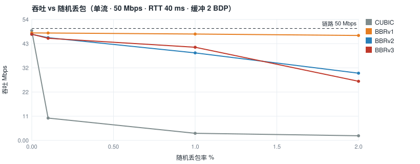

单流吞吐（Mbps）：

| 随机丢包 | CUBIC | BBRv1 | BBRv2 | BBRv3 |
|---|---|---|---|---|
| 0% | 49.0 | 48.0 | 47.4 | 47.4 |
| 0.1% | 10.0 | 48.0 | 45.9 | 45.6 |
| 1% | 3.2 | 47.5 | 39.1 | 41.6 |
| 2% | 2.1 | 46.9 | 30.0 | 26.4 |

缓冲 2 BDP。0.5 BDP 时结论相同（2% 丢包时 v2 / v3 为 29.0 / 23.3 Mbps）。

- 无丢包时三个 BBR 都比 CUBIC 低 1.5–3%：v1 来自 1% 的 pacing margin，v2/v3 还要加上 CRUISE 阶段留出的 15% 余量和 ProbeRTT 的停顿。
- v2/v3 把 2% 当作"在途过多"的信号。随机丢包率接近这个值时，每次探测都会触发 inflight_hi 下调，吞吐被压低。v1 不看丢包，所以不受影响。代价体现在下一节：v1 在浅缓冲下的拥塞丢包也不会退让。

## 2. 排队时延

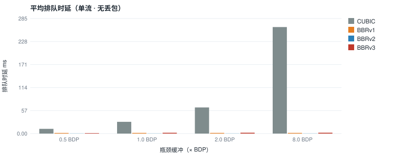
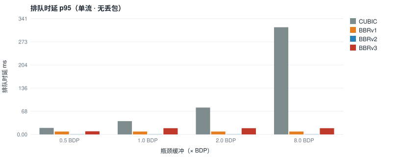

单流、无随机丢包，排队时延（ms，avg / p95 / p99）：

| 缓冲 | CUBIC | BBRv1 | BBRv2 | BBRv3 |
|---|---|---|---|---|
| 0.5 BDP | 11.7 / 19.2 / 19.7 | 1.5 / 8.5 / 10.1 | 0.3 / 0.4 / 5.7 | 1.1 / 9.3 / 19.6 |
| 1 BDP | 29.2 / 39.2 / 39.7 | 1.5 / 8.5 / 10.2 | 0.2 / 0.4 / 5.7 | 2.0 / 18.3 / 32.4 |
| 2 BDP | 64.8 / 79.1 / 79.7 | 1.5 / 8.5 / 10.2 | 0.2 / 0.4 / 5.7 | 2.0 / 18.3 / 32.4 |
| 8 BDP | 264.3 / 315.4 / 319.7 | 1.5 / 8.5 / 10.2 | 0.2 / 0.4 / 5.7 | 2.0 / 18.3 / 32.4 |

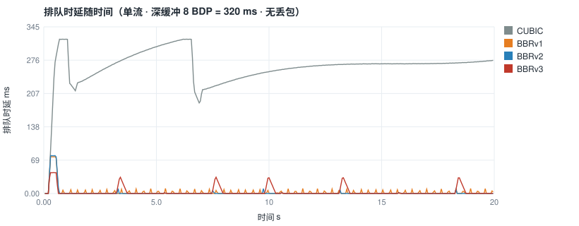

- CUBIC 的排队随缓冲线性增长，8 BDP 时平均 264 ms，这是典型的 bufferbloat。
- 三个 BBR 在 1 BDP 以上与缓冲大小无关，说明它们的稳态在途量由模型决定，不会去填满缓冲。
- v2 最低，是因为 DOWN 阶段的 0.75 增益会把 UP 造成的队列彻底排空。v3 的 DOWN 只有 0.90，UP 的 cwnd_gain 又是 2.25，所以单次探测能堆起约 30 ms 的队列（时间序列图里每 2–3 s 一个尖峰），排完的速度也比 v2 慢。

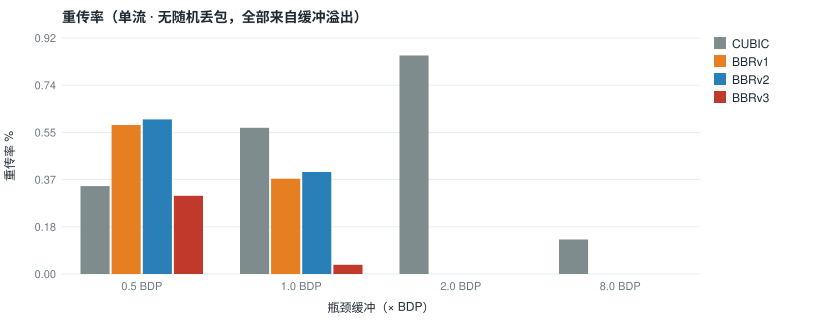

单流、无随机丢包，重传率（%），全部来自缓冲溢出：

| 缓冲 | CUBIC | BBRv1 | BBRv2 | BBRv3 |
|---|---|---|---|---|
| 0.5 BDP | 0.34 | 0.58 | 0.60 | 0.31 |
| 1 BDP | 0.57 | 0.37 | 0.40 | 0.04 |
| 2 BDP | 0.85 | 0.00 | 0.00 | 0.00 |
| 8 BDP | 0.14 | 0.00 | 0.00 | 0.00 |

浅缓冲下 v3 的重传率最低。第一次探测撞上缓冲后，inflight_hi 记住了这个在途量，之后的 UP 碰到它就提前收手，见 `Bbr3Cc::IsTimeToGoDown` 的 precautionary 分支。v2 也有 inflight_hi，但它的 UP 一直推到 1.25 BDP 才退出，0.5 BDP 缓冲装不下这 0.25 BDP 的额外在途量，所以重传率和 v1 接近。

## 3. 公平性

### 3.1 同算法 4 流

4 条同算法流每隔 2 s 启动一条，测量 10–30 s：

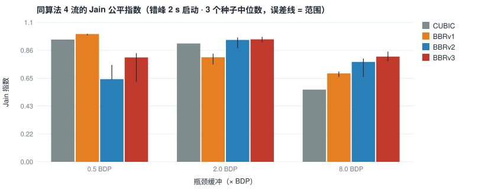

Jain 公平指数（中位数，括号内为 3 个种子的范围）：

| 缓冲 | CUBIC | BBRv1 | BBRv2 | BBRv3 |
|---|---|---|---|---|
| 0.5 BDP | 0.95 (0.95–0.95) | 0.99 (0.98–0.99) | 0.64 (0.64–0.75) | 0.81 (0.62–0.84) |
| 2 BDP | 0.92 (0.92–0.92) | 0.81 (0.75–0.84) | 0.94 (0.88–0.96) | 0.95 (0.93–0.97) |
| 8 BDP | 0.56 (0.56–0.56) | 0.68 (0.66–0.70) | 0.77 (0.66–0.80) | 0.82 (0.78–0.85) |

平均排队 / 重传率：

| 缓冲 | CUBIC | BBRv1 | BBRv2 | BBRv3 |
|---|---|---|---|---|
| 0.5 BDP | 16 ms / 0.34% | 19 ms / 8.96% | 16 ms / 1.66% | 16 ms / 1.50% |
| 2 BDP | 68 ms / 0.74% | 53 ms / 2.82% | 50 ms / 0.76% | 57 ms / 0.73% |
| 8 BDP | 274 ms / 0.17% | 101 ms / 0.54% | 106 ms / 0.82% | 196 ms / 0.77% |

CUBIC 不用随机数，链路无随机丢包，所以 3 个种子结果完全一样，范围为 0。

| BBRv1 | BBRv3 | CUBIC |
|---|---|---|
| 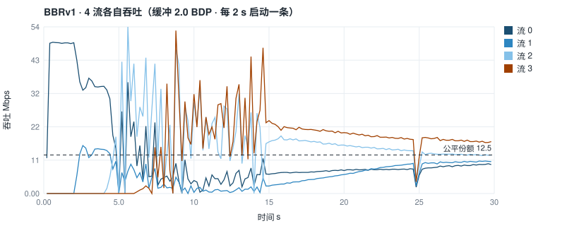 | 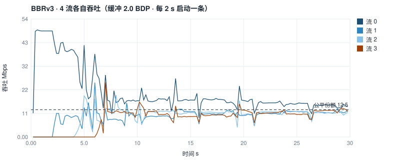 | 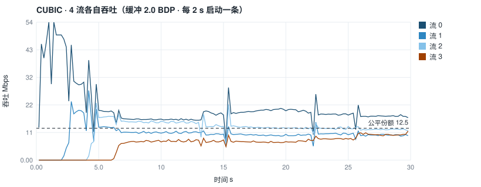 |

（2 BDP 缓冲，种子 0 的每流吞吐。）

- 2 BDP 是最有代表性的中等缓冲。v2/v3 收敛到接近公平，v1 的份额差出 3 倍，且重传率是 v2/v3 的 4 倍。
- **0.5 BDP 时 v1 的 Jain 最高，但这不是优点。** 4 条 v1 流都不理会丢包、一起把缓冲打满，重传率接近 9%，份额是在持续拥塞丢包里被"平均"出来的。v2/v3 的重传率只有 1.5%，代价是先拿到 inflight_hi 的流会把份额守住，后来的流很难抢回来。
- **8 BDP 时 v3 的平均排队（196 ms）比 v1/v2（约 100 ms）高。** 逐流打印模型状态（每 2 s 一次，单独的调试程序，未入库），看到的是：后启动的流进入时缓冲里已经有几百毫秒的积压，它们测到的 min_rtt 被抬高到 100–250 ms，BDP 估计随之虚高，形成持续的驻留队列，要等 ProbeRTT 把大家的在途同时压下去才会恢复。这是 BBR 的已知问题（迟到者高估 min_rtt）。v3 的 DOWN 增益 0.90 排队能力比 v2 的 0.75 弱，所以更难把这部分队列清掉。这一段机理是根据探针输出推断的，没有做对照实验去隔离单一因素。

### 3.2 与 CUBIC 共存

1 条 X 对 1 条 CUBIC，同时启动，测量 5–30 s：

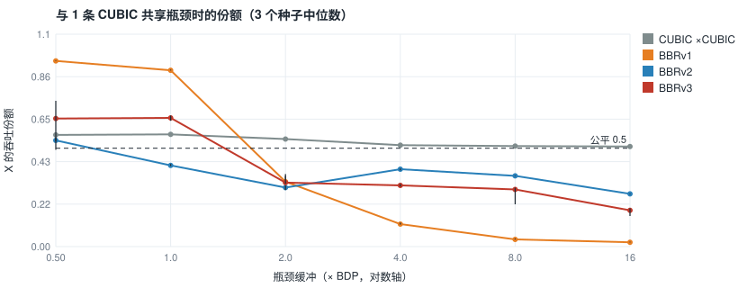

X 的吞吐份额（3 个种子中位数）：

| 缓冲 | BBRv1 | BBRv2 | BBRv3 |
|---|---|---|---|
| 0.5 BDP | 0.94 | 0.54 | 0.65 |
| 1 BDP | 0.90 | 0.41 | 0.65 |
| 2 BDP | 0.33 | 0.30 | 0.33 |
| 4 BDP | 0.11 | 0.39 | 0.31 |
| 8 BDP | 0.04 | 0.36 | 0.29 |
| 16 BDP | 0.02 | 0.27 | 0.18 |

灰线是 CUBIC 对 CUBIC 的对照，说明这个拓扑本身没有偏向。

- v1 在浅缓冲下不理会丢包，CUBIC 不断降窗，于是 v1 拿走 90% 以上。
- **更正：深缓冲下 v1 的 0.02–0.11 不是稳态。** 同样配置跑 3 分钟、只统计 120–180 s，v1 的份额是 0.39（8 BDP）和 0.33（16 BDP），与 Google 的结果一致（见第 4 节）。原因在启动：两条流同时启动时，CUBIC 很快把队列填满，v1 进了 Drain 之后在途量被队列垫着，降不到 1 BDP，一直出不了 Drain；Drain 的 pacing 增益只有 0.35，测到的都是低速样本，10 轮的带宽窗口随之滚动遗忘，btlbw 每 2.5 s 掉到原来的 1/3（24 → 8 → 2.9 → 1.0 Mbps），要 10 s 以上才进入 ProbeBW 慢慢爬回来。25 s 的测量窗口正好落在这段恢复期里。之前写的"cwnd 上限按最小 RTT 算、在途量远少于 CUBIC"是推测，没有被这次的逐流打印支持，已删掉。
- 同样的瞬态也压低了 v2/v3 在深缓冲下的数字：长窗口下 v3 在 8 BDP 时是 0.51、16 BDP 时 0.33，v2 是 0.37 和 0.28。表里的值应理解为"启动后 25 s 内的平均份额"。
- v2/v3 把这条曲线压平到 0.2–0.65。浅缓冲下 inflight_hi 和 bw_lo 让它们在丢包时退让；深缓冲下 Reno 共存探测（探测间隔不超过 BDP 包数个轮次）让它们比 v1 更频繁地去试更高的在途量。
- 稳态下深缓冲份额仍低于 50%（16 BDP 时三个版本都在 0.28–0.33）。CUBIC 的在途量随缓冲一起涨，BBR 的 cwnd 只有约 2 × 估计 BDP，这和 Google、MPI、KIT 的观察一致。

### 3.3 RTT 公平性

2 条同算法流，RTT 分别为 40 ms 和 160 ms，缓冲 2 BDP（按 40 ms 算）：

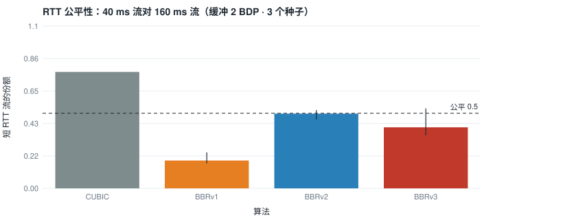

| | CUBIC | BBRv1 | BBRv2 | BBRv3 |
|---|---|---|---|---|
| 短 RTT 流份额 | 0.78 (0.78–0.78) | 0.19 (0.17–0.24) | 0.50 (0.46–0.52) | 0.41 (0.35–0.53) |

- CUBIC 偏向短 RTT 流，因为窗口增长按 RTT 计，短 RTT 流涨得快。
- v1 偏向长 RTT 流，因为 cwnd = 2 × 带宽 × min_rtt，长 RTT 流的 BDP 是短 RTT 流的 4 倍，同样的带宽份额能放进更多在途数据，在共享队列里占的比例更大。
- v2/v3 有 inflight_hi 和每 5 s 一次的 ProbeRTT，长 RTT 流的在途优势被大幅削弱。v3 的种子间波动明显大于 v2，因为它的 UP 是按带宽平台退出、而不是按固定的 1.25 BDP 退出，探测深度取决于两条流的相位关系。

## 4. 与已发表结果对照

把 Google、MPI、KIT 公开的实验配置在仿真器里照搬一遍（`xport_ccexp --only rep_<name>`，3 个种子中位数，数据在 `build/exp/rep_*.csv`）。已发表的数值是从 slides 的图上目测读取的，误差约 ±2 Mbps / ±0.02。

| 简称 | 来源 |
|---|---|
| G105 | Google，BBR v2 alpha 实验室结果，IETF 105（2019）[slides](https://datatracker.ietf.org/meeting/105/materials/slides-105-iccrg-bbr-v2-a-model-based-congestion-control-00.pdf) |
| G117 | Google，BBRv3 bug fix 与参数调整，IETF 117（2023）[slides](https://datatracker.ietf.org/meeting/117/materials/slides-117-ccwg-bbrv3-algorithm-bug-fixes-and-public-internet-deployment-00.pdf) |
| MPI | Zeynali et al., Promises and Potential of BBRv3，IETF 121 [slides](https://datatracker.ietf.org/meeting/121/materials/slides-121-iccrg-promises-and-potential-of-bbrv3-00.pdf) |
| KIT | Bless et al., Insights into BBRv3's Performance and Behavior，IETF 123（2025）[slides](https://www.ietf.org/proceedings/123/slides/slides-123-ccwg-insights-into-bbrv3-performance-and-behavior-bless-00.pdf) |

| 对照项 | 已发表 | xport 复刻 | 判定 |
|---|---|---|---|
| G105 p10：X 对 CUBIC（X 晚 2 s 启动，50 Mbps，30 ms），0.1/1/2/4/8/16 BDP，v1 吞吐 | 45 / 43 / 29 / 19 / 19 / 17 Mbps | 45.3 / 44.3 / 32.0 / 19.8 / 19.5 / 16.8 | 吻合 |
| 同上，v2 | 30 / 17.5 / 20 / 16 / 16 / 10.5 | 23.1 / 24.0 / 14.2 / 17.9 / 14.9 / 20.0 | 范围相同（10–30 Mbps），曲线形状不同 |
| G105 p7：两流 p50 srtt（50 Mbps，30 ms） | v1/v2 53–69 ms；CUBIC 10 BDP 时约 280 ms | v1 58–60，v2 53–67，v3 51–66；CUBIC 282 | 吻合 |
| G105 p11：0.02 BDP 重传率，1 / 10 流 | v1 约 3.5 / 14.5%；v2 约 0.4 / 0.7%；CUBIC 约 0 | v1 3.76 / 13.64；v2 0.57 / 2.80；v3 0.47 / 2.51；CUBIC 0.01 / 0.15 | v1、CUBIC 吻合；v2 在 10 流时偏高约 4 倍 |
| G105 p6：吞吐 vs 随机丢包（1 BDP，100 ms，按占链路比例比） | v2：1% 时 61%，2% 时 4%；v1：10% 时仍有 78% | v2：1% 时 84%，2% 时 39%，3% 时 21%；v1：5% 时 30%，10% 时 12% | 不吻合 |
| MPI p37：RTT 160 对 10 ms，2 BDP，Jain | v1 0.557，v2 0.568，v3 0.586 | 缓冲按 160 ms 算：v1 0.554，v2 0.553，v3 0.677 | v1/v2 吻合，v3 偏高 |
| MPI p37：RTT 160 对 80 ms，2 BDP，Jain | v1 0.654，v2 0.714，v3 0.652 | 缓冲按 160 ms 算：v1 0.664，v2 0.991，v3 1.000 | v1 吻合，v2/v3 不吻合 |
| MPI p45：v3 对 CUBIC，浅缓冲 | v3 拿约 85%，比 v2 更不让 CUBIC | 本报告 0.5–1 BDP：v3 0.65，v2 0.41–0.54 | 方向一致，幅度更小 |
| KIT p8/p25：单流 8 BDP 排队 | v3 峰值高于 v1，最高约 1.3 RTTmin | v3 p95 18 ms、p99 32 ms（0.8 RTTmin）；v1 p95 8.5 ms | 方向一致 |
| G117 p6–7：v3 在大缓冲下同算法流收敛、v2 不收敛 | 定性（只有时间序列图） | 3.1 节 8 BDP：v3 Jain 0.82，v2 0.77 | 方向一致，差距较小 |

复刻做了两处缩放：G105 p6 和 p11 原文是 1 Gbps × 100 ms，BDP 12.5 MB 超过了当时的在途包表容量（固定 8192 包 ≈ 11 MB，现已改为按需扩容），改成 50 Mbps，RTT 和缓冲倍数不变；G105 p7 的 100 BDP 超过 CUBIC 默认 max_cwnd，只跑了 1 和 10 BDP。缩放后 BDP 小了 20 倍，所以 G105 p6 里 CUBIC 的绝对数不可比，这一项只看 BBR。MPI 没写 2 BDP 按哪条流的 RTT 算，两种都跑了，表里列的是按长 RTT 流算的；按短 RTT 流算时 v1/v2/v3 在 160 对 10 ms 下是 0.65 / 0.70 / 0.76，160 对 80 ms 下是 0.72 / 0.63 / 0.93。

**结论**：v1 的实现和 Google 的结果基本对得上；时延维度（p50 srtt、单流排队）三个版本都对得上。v2/v3 在三处与发表值不符：高随机丢包下掉得比 Google 慢、10 流浅缓冲重传偏高、RTT 160 对 80 ms 时公平性高得不像 BBR。v1 在 5% 以上随机丢包时掉得比 Google 快得多，这一项也不符。

下面是推测，都还没有做单独的对照实验：v1 高丢包下的差距更可能来自 xport 的丢包恢复（RFC 9002 的判丢阈值和 PTO），而不是 BBR 本身；v2/v3 的三处差异可能和没实现 ECN 与 offload budget、仿真链路没有 netem 那样的批量出队、以及 Linux 实现里本报告没覆盖的细节有关。在弄清楚之前，本报告里 v2/v3 的绝对数值只能当作"这个实现在这个仿真器里"的结果，不能当作 BBRv2/v3 本身的性能。

另外，做 G105 p10 复刻时发现传输层的一个 bug：接收端区间表（512 段）满时，数据被丢掉，包却照样被 ACK，发送端不再重传，流永久卡死。现象是 8 BDP 时 v1 吞吐为 0。已修复，并补了回归用例 `RecvRangeOverflowDoesNotAckUnrecordedData`。前面 1–3 节的所有 CSV 修复前后逐字节一致，所以本报告已发布的数字不受影响。

## 局限

- 只有一种链路速率（50 Mbps）和一种基础 RTT（40 ms，RTT 公平性实验除外）。高 BDP（Gbps × 100 ms）和极低 BDP 下的行为没有覆盖。
- 瓶颈是尾丢弃的 FIFO，没有 AQM（CoDel / FQ）。有 FQ 时公平性主要由调度器决定，结论会很不一样。
- 随机丢包是独立同分布的，没有突发丢包，也没有链路层重传造成的时延抖动。
- 多流实验每个配置只有 3 个种子。BBR 的份额对探测相位很敏感，表里的范围说明 3 个种子不足以给出紧的置信区间，结论只适合看量级和趋势。
- v2 参数取自 Linux v2alpha 分支（已停止维护），v3 取自 draft-06。与 Linux v3 分支相比，没有实现 ECN、undo、idle restart 和 TSO 相关的 offload budget。

## 原始数据

`xport_ccexp` 默认写 6 个 CSV（`build/exp/`），另有 6 组复刻实验用 `--only rep_loss|rep_qdelay|rep_coexist|rep_retx|rep_rtt|rep_long` 单独跑，写 `rep_*.csv`：

| 文件 | 内容 |
|---|---|
| `single.csv` | 单流：算法 × 缓冲 × 丢包 → 吞吐、排队分位数、重传率 |
| `single_ts.csv` | 单流时间序列（8 BDP、无丢包），50 ms 一点 |
| `intra.csv` / `intra_ts.csv` | 同算法 4 流，逐种子；时间序列只记种子 0 |
| `inter.csv` | 1 条 X 对 1 条 CUBIC，逐种子 |
| `rtt.csv` | RTT 40 ms 对 160 ms，逐种子 |
